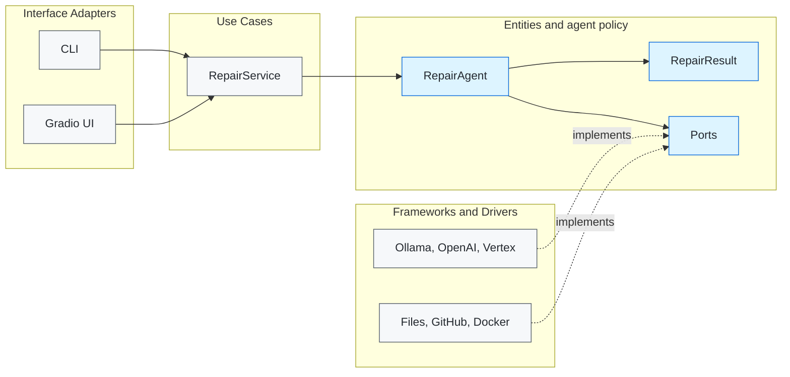
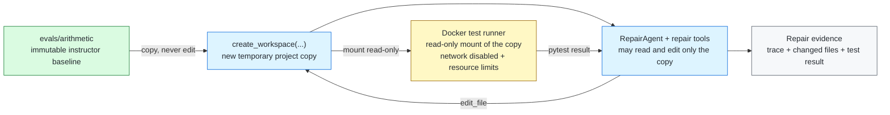
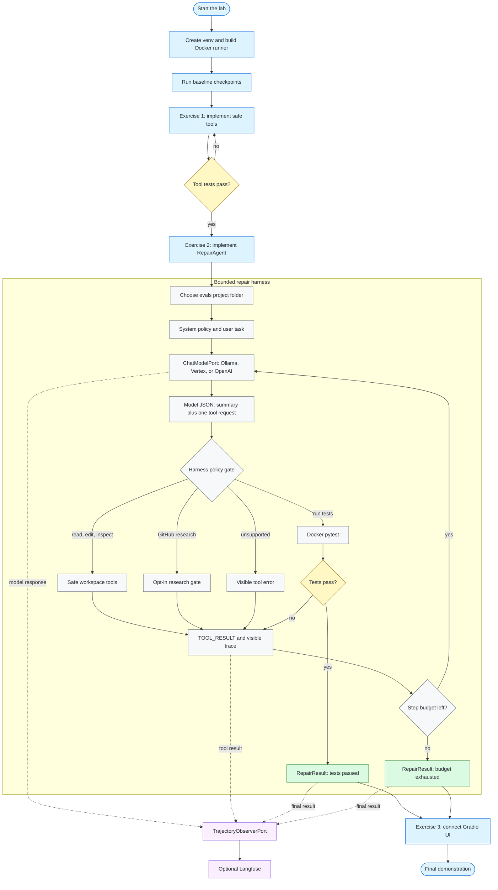

# Build Your Own Python Repair Agent

Build a coding agent that reads a small Python project, edits it, and verifies the repair with sandboxed tests. This lab uses Robert C. Martin's **Clean Architecture** vocabulary and its **Dependency Rule**: source-code dependencies point inward, never from policy to volatile details. The outer layers are concrete **Adapters**; the inner layers own **Ports** (Python `Protocol`s).



### How the layers map to this repository

- `core/` — **Entities**, **Use Cases**, and policy-owned **Ports**. It contains the repair policy and does not import user interfaces, Docker, model SDKs, GitHub, or Langfuse.
- `adapters/` — **Interface Adapters** plus **Frameworks & Drivers**. It translates the core's ports to concrete technologies.
  - `models/ollama.py` owns the Ollama integration; the OpenAI and Vertex adapters follow the same boundary.
  - `research/github_research.py` is the optional external-research adapter.
  - `observability/langfuse.py` is the optional trajectory-recorder adapter.
  - `sandbox/` owns the disposable workspace and Docker isolation.
  - `gradio_ui.py` remains a small presentation adapter at the package root.
- `evals/` — fixed, reproducible repair and evaluation fixtures.
- `bootstrap.py` — the **Composition Root**. It is the one outer-edge location that performs **Dependency Injection** by connecting concrete adapters to core ports.
- `core/ports.py` — the **Ports and Adapters (Hexagonal Architecture)** contracts. Concrete adapters satisfy these contracts; the core depends only on the contracts.
- `adapters/sandbox/runner.py` — the execution boundary. Generated project code runs only in its Docker runner, never directly on the host.

This follows the **Dependency Rule**: source-code dependencies point inward, from volatile technology details toward stable policy. [Martin’s Dependency Rule](https://www.informit.com/articles/article.aspx?p=2832399), [AWS on Hexagonal Architecture](https://docs.aws.amazon.com/prescriptive-guidance/latest/cloud-design-patterns/hexagonal-architecture.html)

## Setup

Prerequisites: Python 3.10 or later (3.11 recommended) and Docker Desktop. Check that Docker is running before building the isolated test runner.

```bash
cd coding-agent-lab
python3 --version
python3 -m venv .venv
source .venv/bin/activate
pip install -r requirements.txt
docker info
docker build -t coding-agent-lab-runner adapters/sandbox
pytest -q
```

The first test run should fail with clear `NotImplementedError` messages from the exercises. This is expected. You do **not** need an LLM, an API key, GitHub research, or Langfuse to complete Exercises 1 and 2: their checkpoints use `ScriptedClient`.

`docker info` must succeed. If it does not, start Docker Desktop before building the isolated runner.

### Required 2.5-hour path

1. Complete Exercise 1 and its tool checkpoint.
2. Complete Exercise 2 and its deterministic agent-loop checkpoint.
3. Complete Exercise 3 and launch the UI.
4. After the checkpoints pass, choose one [model provider for the live final demonstration](docs/model-providers.md).

The GitHub-research and Langfuse sections are optional extensions; skip them on the first pass through the lab.

## Architecture map

| Clean Architecture ring | Lab package | Responsibility |
| --- | --- | --- |
| Interface Adapters | `main.py`, `adapters/gradio_ui.py`, `adapters/sandbox/repair_tools.py` | Terminal/Gradio translation and the safe repair-tool adapter. |
| Use Cases | `core/repair_service.py` | The `RepairService` repair use case. |
| Entities / policy | `core/models.py`, `core/prompts.py`, `core/repair_agent.py`, `core/ports.py` | `RepairResult`, model-facing prompt policy, agent-loop policy, and ports. |
| Frameworks & Drivers | `adapters/models/ollama.py`, `adapters/research/github_research.py`, `adapters/observability/langfuse.py`, `adapters/sandbox/runner.py` | Model/GitHub/Langfuse integration, filesystem, and restricted Docker execution. |
| Composition Root | `bootstrap.py` | Wires concrete adapters to ports using dependency injection. |

## One entry point

Run `main.py`; it is the only application entry point. `bootstrap.py` is imported by `main.py` and is not a program to run directly.

```bash
python main.py repair evals/arithmetic
python main.py repair evals/arithmetic --provider ollama --model qwen2.5-coder:7b
python main.py ui
```

## Project selection and repaired code

The terminal accepts one instructor-provided project folder under `evals/`, for example `evals/arithmetic` or `evals/multi_function`. The short names `arithmetic` and `multi_function` are accepted as convenience aliases. A path outside `evals/`, the `evals/` directory itself, path traversal, arbitrary uploads, and arbitrary host directories are rejected.

For every repair, the harness copies the selected project into a new disposable workspace. It edits and tests only that copy. The CLI prints the changed source files after the trace; Gradio displays them and provides the repaired workspace as a ZIP download.

### Why the project copy and Docker sandbox are both necessary



The **copy** preserves a reproducible baseline: every repair begins from the same instructor fixture, and the original under `evals/` remains available for comparison. Docker is a different control: it is the **execution sandbox**. It runs project tests from a read-only mount with no network and resource limits, so generated project code never runs on the host. A copy protects the fixture; a sandbox constrains execution. We use both.

## The agent harness

An **agent harness** is the software surrounding an LLM that turns a single text-generation call into a bounded, observable workflow. The model supplies decisions; the harness owns the engineering controls.

Follow the diagram from top to bottom. Solid arrows are the repair workflow; dotted arrows are trace events. GitHub renders this Mermaid diagram directly in the README.



In this lab, `core/repair_agent.py` is the **harness controller**. Its responsibilities are to construct the task context, maintain conversation state, parse model requests, dispatch only approved tools, record a trace, return observations to the model, and stop on passing tests or a fixed budget. The LLM adapter never gains shell access or direct access to the host project.

### Program-repair rule: reproduce before repair

A repair begins with evidence, not a plausible-looking code change. The supplied `evals/` fixtures are designed to fail reproducibly in the Docker runner. The system prompt therefore requires this sequence: inspect a test, run it to observe the failure, make a focused edit, then run the tests again. A passing post-edit result is the repair verdict. If the initial test run passes or cannot run, do not make a speculative change—keep the trace and report the unexpected baseline result to the instructor.

`core/prompts.py` keeps the model-facing conversation policy separate from loop control. It defines the `system`, `user`, and `assistant` role constants; the base system policy; the optional GitHub-research policy; the case request template; and the `TOOL_RESULT` formatter. `RepairAgent` imports these pieces rather than embedding long prompts.

`core/ports.py` is the **harness boundary**: it defines what a model can ask for (`RepairToolsPort`), what a provider must supply (`ChatModelPort`), and the optional `TrajectoryObserverPort`. `adapters/sandbox/` is the **tool runtime**, and `evals/` supplies fixed tasks. This separation lets students replace Ollama with a cloud provider, replace the UI, record to Langfuse, or test with `ScriptedClient` without rewriting the harness.

## State-of-practice patterns retained in this small lab

This is intentionally a teaching-sized harness, not a clone of a production coding-agent platform. It retains the engineering patterns that established repositories make visible:

- [Aider](https://github.com/Aider-AI/aider) uses repository context and verifies edits with linting and tests. This lab provides the selected fixture's file list, requires test inspection before editing, and makes `run_tests` the repair verdict.
- [SWE-agent](https://github.com/SWE-agent/SWE-agent/blob/main/docs/usage/trajectories.md) persists model response, action, observation, state, and exact model input as a trajectory. This lab records the messages, model response, tool result, terminal result, and a short public action `summary`; Gradio and optional Langfuse expose that trajectory.
- [OpenHands](https://github.com/OpenHands/OpenHands) and [Codex](https://github.com/openai/codex/blob/main/codex-rs/utils/cli/src/shared_options.rs) make the execution environment and approvals explicit. This lab keeps project code in a Docker runner, supplies only bounded tools, and makes external research and observability opt-in.

Production agents additionally use repository maps, context compaction, Git/worktree review, provider-native structured tool calls, richer test/lint/build commands, and human approval workflows. Those are valuable later extensions; adding them now would hide the repair loop students need to learn.

The lab asks the model for JSON so students can see parsing and tool dispatch directly. When a provider supports schema/function calling, a production adapter can translate its structured tool call into the same `RepairToolsPort`; the core capability policy and test-verification loop should remain unchanged.

## Internet access is a deliberate tool-policy decision

This lab is **offline by default**. The agent may inspect only the selected evaluation fixture and run its supplied tests. It has no web-search, browser, host-shell, package-installation, or arbitrary-upload tool unless an instructor or student explicitly enables the optional GitHub-research extension below.

That choice is intentional:

- Repairs are reproducible: the same fixture and test result do not depend on changing web pages or search rankings.
- Evaluation is fair: every student agent receives the same evidence.
- The attack surface is smaller: untrusted web content cannot steer the model, and generated code cannot exfiltrate data through a network tool.
- Students can first observe the essential harness loop—context → model decision → bounded tool → observation—without a second, unrelated retrieval system.

## Optional GitHub research — advanced extension

This repository includes one concrete research integration so students can study how a coding agent is given Internet evidence. It is deliberately **off by default**. When enabled, `adapters/research/github_research.py` calls only GitHub's code-search API; it is not a browser and it cannot fetch arbitrary URLs.

```bash
export GITHUB_TOKEN="your-fine-grained-token"
python main.py repair evals/multi_function --research
```

For the Gradio interface, set `ENABLE_GITHUB_RESEARCH=true` in the same terminal before running `python main.py ui`.

`--research` creates the adapter in `bootstrap.py`, sets `research_enabled=True` on the harness, and gives the model one extra request shape:

```json
{"tool":"search_github","query":"normalize_name language:Python"}
```

The adapter permits at most three requests per repair, three results per request, a one-line query of at most 180 characters, and a single trusted API domain (`api.github.com`). The harness rejects `search_github` until the model has successfully called `read_file` on a local file. Its `TOOL_RESULT` contains visible provenance: repository, path, GitHub URL, short matching snippet, retrieval time, and whether GitHub marked the response incomplete. The model must still inspect the local project and use `run_tests`; Internet material is an untrusted hint, not a repair verdict.

GitHub code search uses its own authentication and rate limits, so this lab requires `GITHUB_TOKEN` when research is enabled. Keep the token in an environment variable—not the repository or model prompt. [GitHub Search API documentation](https://docs.github.com/en/rest/search/search#search-code)

**Privacy rule:** do not enable this option for a repository containing credentials, personal data, proprietary code, or other confidential material. The adapter itself cannot read project files, but an LLM that has read project context could place information into a research query. This lab's instructor-provided fixtures are safe for the demonstration.

For any repair, students should be able to state the policy: **offline fixture evidence is sufficient**, or **external, cited documentation is needed**. The harness—not the model—enforces that policy.

## Tool capability levels

The agent has three basic repair tools: `read_file`, `edit_file`, and `run_tests`. They make its authority easy to see: it can read an approved workspace, edit only that workspace, and execute tests only in Docker.

For a repository with many files, the harness also supplies `run_command(command)`. This is **not a host shell** and is not a general terminal. It accepts a short command string, parses it without a shell, and permits only the read-only inspection commands `find`, `grep`, and `ls`. It runs in the same Docker container with no network, a read-only project mount, CPU/memory/PID limits, a 10-second timeout, and a bounded display result. It cannot edit the project or replace `run_tests`.

When GitHub research is explicitly enabled, `search_github(query)` is a separate **external evidence** capability. Unlike `run_command`, it makes a network request from the outer research adapter, never from Docker. This distinction is intentional: the harness gives each capability a clear boundary and trace.

Examples:

```json
{"tool":"run_command","command":"find . -maxdepth 2 -type f"}
{"tool":"run_command","command":"grep -R \"normalize_name\" ."}
```

The runner rejects commands such as `python`, `pip`, `curl`, `sh`, and `rm`. This demonstrates an industry principle: give an agent the **least powerful capability that solves the task**, then expand it deliberately as repository complexity grows.

## Exercises — complete in order

Run each checkpoint from the repository root. Exercises 1 and 2 need no model provider or API key.

1. [Exercise 1 — Safe tools (25 minutes)](docs/exercises/01-safe-tools.md) — implement the workspace-scoped read, edit, and test tools.
2. [Exercise 2 — Agent loop (65 minutes)](docs/exercises/02-agent-loop.md) — implement the model-to-tool repair harness.
3. [Exercise 3 — Gradio UI adapter (20 minutes)](docs/exercises/03-gradio-ui.md) — present the repair result in the provided interface.

## Model provider for the live demonstration

After Exercises 1 and 2 pass, follow [Model providers — choose one for the live demonstration](docs/model-providers.md). It covers local Ollama, Vertex AI Gemini, and the OpenAI API. No provider is needed for the deterministic checkpoints.

## Optional observability extension

After the core lab, follow [Optional Langfuse observability — trajectory analysis extension](docs/observability.md) to analyze repair trajectories across runs. It is not required for any exercise checkpoint.

## Final demonstration

1. Show `pytest -q` passing.
2. Explain model JSON → tool → `TOOL_RESULT` → model.
3. Point out the harness controls and explain why the model is not trusted with host shell execution.
4. Show why `RepairAgent` can be tested with `ScriptedClient` and `RepairTools` without Gradio/Ollama.
5. Run **arithmetic** through the CLI or Gradio UI with one configured provider (Ollama, Vertex, or OpenAI).
6. Identify the security boundary: only `adapters/sandbox/runner.py` executes case code or the restricted inspection command, inside Docker—not on the host.
7. Optional: enable GitHub research, show a cited `search_github` observation in the trace, and explain why the returned code is only a hypothesis until local tests pass.
8. Optional: with approved Langfuse credentials, show the agent, generation, and tool observations for one repair; explain the external data boundary.
