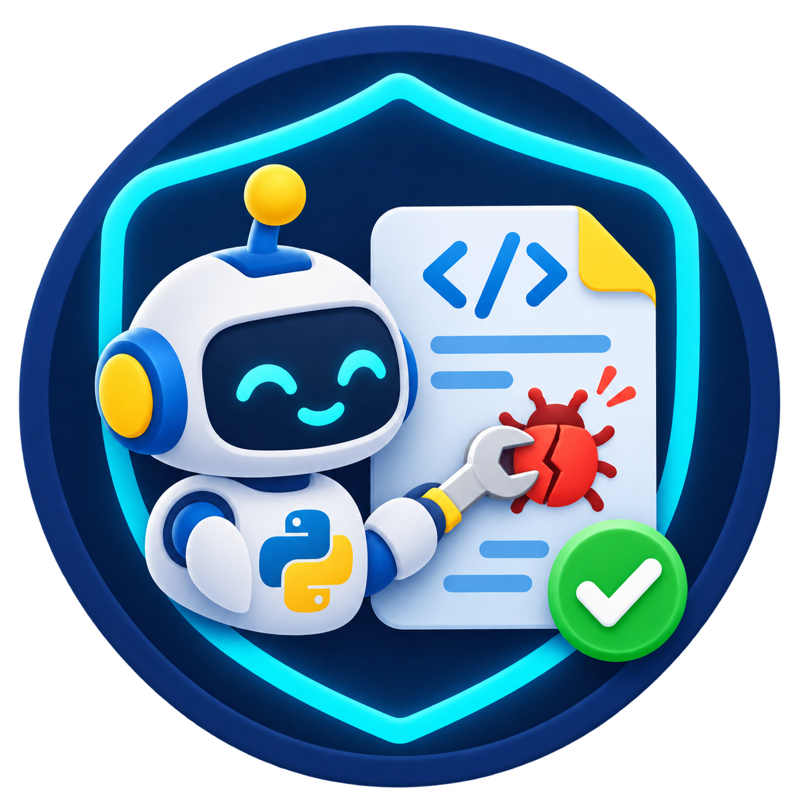

<h1 align="center">Build Your Own Python Repair Agent</h1>

<p align="center">
  
</p>

## A guided, from-scratch activity

In this activity, you will build a small Python repair agent with a vibe-coding assistant such as Codex, Claude Code, or Cursor. The agent receives one buggy Python project and its tests. It must inspect the project, reproduce the failure by testing it, make a focused edit, and verify the repair in a Docker sandbox.

The final output is a visible action trace, a disposable repaired copy of the project, and the final test result.

You are not given agent source code to complete. You will create the folders, files, tests, and implementation yourself. Your coding assistant may write code, but you are responsible for directing it, reviewing its changes, and running every checkpoint.

## Objective

Build a repair agent that:

- works only on one instructor-provided project selected from `evals/`;
- reproduces a failing test before it edits code;
- runs project code only inside Docker;
- accepts only a small, explicit set of model actions;
- stops when tests pass, the model response is invalid, or its decision budget ends; and
- can run from a terminal and a small web interface.

The folder arrangement is deliberate. Keep repair decisions separate from model HTTP calls, Docker commands, file access, and the web page. This makes the repair logic testable with a fake model and lets you replace a technology without rewriting the repair loop.

## What the student version contains

The student release should contain this guide, `LICENSE`, `.gitignore`, the repair-agent icon, and the five fixed evaluation projects in `evals/`. It must not contain an implemented agent, hidden tests, model keys, or a completed Docker runner. Keep the working implementation in the instructor repository only.

The supplied evaluation projects are:

```text
evals/
├── arithmetic/          # small calculator bug
├── balanced_brackets/   # matching-type boundary bug
├── median/              # even-length boundary bug
├── multi_function/      # several text utility functions
└── unique_words/        # order-preservation bug
```

Do not edit files in `evals/`. Your repair agent must copy the selected project into a disposable workspace before it changes anything. The cases are teaching-sized fixtures, not HumanEval+ tasks. They follow the same useful evaluation habit: test ordinary behavior and a boundary or semantic case that a superficial repair can miss.

## How to use a vibe-coding assistant

Work in short stages. For each stage:

1. Give the assistant only the stated task and files.
2. Ask it to run the stated checkpoint.
3. Read the diff before accepting it.
4. Run the checkpoint yourself.
5. Commit the working stage.

Use this prompt pattern whenever you ask for help:

```text
You are helping me build a teaching-sized Python repair agent.

Read the named files before changing anything. Work only on the files listed
in this task. Keep the repair decision code separate from Docker, model HTTP,
and Gradio code. Do not add a host shell, arbitrary project upload, Internet
search, API keys, or packages beyond those requested.

Task: <paste the task for this stage>

Verification: run <paste the command>. Report the actual result and every
file changed. Do not claim success if the command fails.
```

Treat the assistant's output as a proposed change, not proof that the code is correct.

## Safety rules

These rules are requirements, not suggestions.

- The agent may work only on a copied project selected from `evals/`.
- Never execute evaluation-project Python with host Python.
- The host may start Docker, but Docker alone runs `pytest` and generated project code.
- Do not give the model a free-form shell tool.
- Do not provide arbitrary file paths, public uploads, or Internet access in the required activity.
- Reject absolute paths and paths that escape the workspace, such as `../secret.txt`.
- Do not put model or service secrets in source files, commits, or traces.
- Require a failing sandboxed test result before allowing an edit.
- Keep a short public action summary, not private model reasoning.

## Target project structure

Create this structure during the activity. `__init__.py` files make the folders importable Python packages.

```text
coding-agent-lab/
├── README.md                          # this guide in the student release
├── docs/assets/
│   └── python-repair-agent-icon.png    # activity icon
├── requirements.txt
├── pytest.ini                         # limits host pytest to tests/ only
├── main.py                            # terminal entry point
├── bootstrap.py                       # assembles the application
├── core/                              # repair decisions and small data objects
│   ├── __init__.py
│   ├── models.py
│   ├── ports.py
│   ├── prompts.py
│   ├── repair_agent.py
│   └── repair_service.py
├── adapters/                          # concrete I/O and framework code
│   ├── __init__.py
│   ├── gradio_ui.py
│   ├── models/
│   │   ├── __init__.py
│   │   ├── ollama.py
│   │   └── scripted.py
│   └── sandbox/
│       ├── __init__.py
│       ├── Dockerfile
│       ├── runner.py
│       └── repair_tools.py
├── evals/                             # supplied, never modified
│   ├── arithmetic/
│   ├── balanced_brackets/
│   ├── median/
│   ├── multi_function/
│   └── unique_words/
└── tests/                             # tests you write for your agent
    ├── test_tools.py
    └── test_agent.py
```

Files in `core/` must not import anything from `adapters/`. `bootstrap.py` is the only place that chooses concrete implementations and gives them to the repair service.

## 0. Set up the repository and environment, 10 minutes

Fork the student repository, clone your fork, and create a branch for your work.

```bash
git clone https://github.com/YOUR-USERNAME/coding-agent-lab.git
cd coding-agent-lab
git switch -c build-repair-agent
```

Ask your coding assistant to create the target folders, empty package files, `requirements.txt`, and `pytest.ini`. The required packages are `pytest` and `gradio`; use Python 3.11 or newer. `pytest.ini` must set `testpaths = tests` so that a host pytest command never discovers or executes tests inside `evals/`.

```ini
[pytest]
testpaths = tests
```

**macOS or Linux**

```bash
python3 -m venv .venv
source .venv/bin/activate
python -m pip install --upgrade pip
python -m pip install -r requirements.txt
```

**Windows PowerShell**

```powershell
py -m venv .venv
.\.venv\Scripts\Activate.ps1
python -m pip install --upgrade pip
python -m pip install -r requirements.txt
```

If PowerShell blocks activation, run `Set-ExecutionPolicy -Scope Process -ExecutionPolicy Bypass` and activate the environment again.

**Checkpoint**

```bash
python --version
python -m pip check
git status --short
```

At this point, do not run `pytest` from the repository root: the supplied evaluation tests are intentionally buggy and must run only in Docker. Commit the file structure and dependency file before starting implementation.

## 1. Define the agent's small vocabulary, 15 minutes

Create `core/models.py` and `core/ports.py` first. Do not call Ollama, Docker, or Gradio here.

Create small data objects for:

- a test result: `passed`, `output`, and `returncode`;
- an action requested by the model: `tool`, arguments, and optional public `summary`; and
- the final repair result: whether it passed, trace entries, changed files, workspace location, and the most recent test result.

In `core/ports.py`, describe the capabilities that the repair agent needs:

- a chat client with `chat(messages) -> str`;
- repair tools with `read_file`, `edit_file`, and `run_tests`; and
- optionally, a trace recorder with one `record(event, payload)` method.

Use Python `Protocol` types or small abstract interfaces. The repair agent will depend on these descriptions, not on Ollama or Docker classes.

**Prompt for your coding assistant**

```text
Create core/models.py and core/ports.py only. Define minimal typed data
objects for a repair result, test result, and model action. Define interfaces
for a chat client and the three repair tools: read_file, edit_file, run_tests.
Use only the standard library and core modules. Do not import adapters,
Docker, Gradio, or an HTTP client. Add concise docstrings.
```

**Checkpoint**

```bash
python -m compileall -q core
```

## 2. Build the safe workspace and tools, 25 minutes

Create `adapters/sandbox/Dockerfile`, `runner.py`, `repair_tools.py`, and `tests/test_tools.py`.

Your Docker image should contain Python, pytest, and a non-root user. The runner must start a short-lived container with networking disabled and run `pytest -q` against the copied workspace. Mount the workspace into the container without giving the container access to the rest of the host filesystem.

`runner.py` has two jobs:

1. Copy the chosen `evals/<case>` directory to a newly created temporary workspace.
2. Run tests in that workspace through Docker and return a structured test result.

`repair_tools.py` has three methods:

| Method | Required behavior |
| --- | --- |
| `read_file(path)` | Resolve a relative path inside the workspace and return UTF-8 text. |
| `edit_file(path, content)` | Resolve safely, write UTF-8 text, and record the changed relative path once. |
| `run_tests()` | Delegate to the Docker-backed runner and return its test result. |

Write a `safe_path(workspace, requested_path)` helper. It must reject absolute paths and any resolved path outside the workspace. Do not use `subprocess` to run project Python or pytest on the host.

Write tests that prove the following:

1. a normal workspace file can be read;
2. `../` traversal and absolute paths are rejected;
3. an edit is written and appears once in `changed_files`; and
4. `run_tests()` delegates to the runner rather than launching host Python.

**Prompt for your coding assistant**

```text
Implement only adapters/sandbox/Dockerfile, runner.py, repair_tools.py, and
tests/test_tools.py. The host may invoke Docker, but it must never execute a
fixture's Python or pytest directly. Copy a selected eval project into a
temporary workspace. Enforce workspace-relative paths before every read or
write. Implement read_file, edit_file, and run_tests only. Do not add a shell
tool or Internet access. Write focused pytest tests for path containment,
editing, and delegation to the Docker runner.
```

**Checkpoint**

```bash
python -m pytest -q tests/test_tools.py
docker build -t coding-agent-lab-runner adapters/sandbox
```

Expected outcome: your unit tests pass, and Docker builds the runner image. Do not run an evaluation project with host Python to test this stage.

## 3. Add predictable prompts and model clients, 15 minutes

Create `core/prompts.py`, `adapters/models/scripted.py`, and `adapters/models/ollama.py`.

Keep all model-facing text in `core/prompts.py`. The system instruction must tell the model to repair an existing bug, first reproduce it by testing, and respond with exactly one JSON object. It must state that only these tools exist:

```json
{"summary":"Read the failing test","tool":"read_file","path":"test_calculator.py"}
{"summary":"Reproduce the bug","tool":"run_tests"}
{"tool":"edit_file","path":"calculator.py","content":"..."}
```

The prompt should contain the selected case name and a supplied relative file list. This prevents the model from inventing project paths.

`scripted.py` must implement the chat interface with a predetermined sequence of replies. Use it to test the repair loop without a model, token, Internet connection, or Docker execution of generated code.

`ollama.py` must call a local Ollama server. Use `qwen2.5-coder:7b` as the default model, allow `OLLAMA_MODEL` or a CLI option to replace it, and make temperature configurable. Request JSON output from Ollama, but still validate its returned text yourself.

**Checkpoint**

```bash
python -m compileall -q core adapters/models
```

No live model call is required at this stage.

## 4. Implement the repair loop, 40 minutes

Create `core/repair_agent.py` and `tests/test_agent.py`. This is the central part of the activity.

The repair agent must follow this sequence:

```text
selected case and file list
        ↓
system and user messages
        ↓
model returns one JSON action
        ↓
validate action, enforce policy, call one tool
        ↓
append the tool observation to conversation history
        ↓
repeat until a verified repair or a stop condition
```

Implement these requirements:

1. Start with a system message and user message built from `core/prompts.py`.
2. Call `client.chat(messages)` once per decision.
3. Parse exactly one JSON object. Reject prose, Markdown fences, arrays, malformed JSON, duplicate fields, unknown tools, missing fields, and extra fields.
4. Add the model reply to history, then return the tool observation as the next user message.
5. Allow only `read_file`, `run_tests`, and `edit_file`.
6. Require at least one successful local `read_file` action and one failing sandboxed `run_tests` result before an edit.
7. Return success only after a later `run_tests` result passes.
8. Stop and return a failed result after invalid JSON or a fixed decision budget, such as eight decisions.
9. Record visible events named `repair_started`, `model_response`, `tool_result`, and `repair_finished`.

The trace may include the public action summary and tool result. It must not ask the model for hidden reasoning.

Write deterministic tests using `ScriptedClient`. Test a successful repair sequence, invalid JSON that executes no tool, a budget exhaustion, and a rejected edit before a reproduced failing test.

**Prompt for your coding assistant**

```text
Implement only core/repair_agent.py and tests/test_agent.py. Use the existing
core data objects, prompt helpers, and interfaces. Build a bounded loop that
accepts only strict JSON actions for read_file, run_tests, and edit_file. It
must read local code and reproduce a failing sandboxed test before editing.
Append every model reply and tool observation to history, record visible trace
events, and stop on verified tests, invalid JSON, or an eight-step budget.
Use ScriptedClient for deterministic tests. Do not import Docker, Ollama,
Gradio, or adapters from core/repair_agent.py.
```

**Checkpoint**

```bash
python -m pytest -q tests/test_agent.py
python -m pytest -q
```

Expected outcome: all tests you wrote pass. The tests must not contact Ollama or execute generated project code on the host.

## 5. Assemble the command-line repair, 15 minutes

Create `core/repair_service.py`, `bootstrap.py`, and `main.py`.

`repair_service.py` selects an allowed evaluation case, creates its disposable copy, gives the agent the case's relative file list, and returns the final repair result. It must reject paths outside `evals/`.

`bootstrap.py` creates the real tools, model client, and repair service. It is the only file that imports both `core/` and `adapters/` to connect the pieces.

`main.py` provides this command:

```bash
python main.py repair evals/arithmetic --provider scripted
```

Print each visible trace event as it occurs, then print the changed files and final sandboxed test result. Configure the scripted client with a known valid sequence that repairs the arithmetic fixture. This makes a complete end-to-end check possible without an LLM.

**Checkpoint**

```bash
python main.py repair evals/arithmetic --provider scripted
python main.py repair evals/multi_function --provider scripted
```

Expected outcome: each command prints a trace that shows local inspection, a failing test, an edit, and a passing test. The original files under `evals/` remain unchanged.

## 6. Add the Gradio interface, 20 minutes

Create `adapters/gradio_ui.py`. It is a presentation layer, not another repair agent.

The page must:

- offer only the five supplied evaluation projects as project choices;
- start the same repair service used by the terminal;
- show the execution trace, changed file content, and final test output; and
- provide a ZIP file containing the repaired disposable workspace.

Do not add a file-upload component. Do not build prompts, call Docker directly, or make policy decisions in the UI.

Add a `ui` command to `main.py`:

```bash
python main.py ui
```

**Checkpoint**

```bash
python -c "from adapters.gradio_ui import create_demo; create_demo(); print('Gradio UI built')"
python main.py ui
```

Expected outcome: the first command builds the interface. In the browser, selecting `arithmetic` produces the same kind of trace and result as the terminal command.

## 7. Run a live Ollama repair, 10 minutes

This step needs Docker Desktop running and an available Ollama installation. It is not needed for deterministic unit tests.

```bash
ollama pull qwen2.5-coder:7b
ollama list
python main.py repair evals/arithmetic --provider ollama --model qwen2.5-coder:7b --temperature 0.0
```

You may use another installed coding model by changing `--model`. Record the provider, model identifier, temperature, fixture, Git revision, final test result, and visible trace. A live model is not deterministic, so do not expect its wording or sequence to match another group's run.

If Ollama, Docker, or the model is unavailable, show the scripted end-to-end repair and state the missing dependency. Do not report an unperformed live run as successful.

## Final demonstration

Demonstrate these five points:

1. Start from the original `evals/arithmetic` project and show its sandboxed failing test.
2. Run a scripted or live repair through the terminal and show the trace: read, reproduce, edit, verify.
3. Show that the repaired files are in a copied workspace and that the original evaluation project is unchanged.
4. Show your deterministic tests for safe paths and the repair loop.
5. Explain why the repair loop does not directly import the web page, Docker command, or Ollama client.

## Submission checklist

- [ ] All source files in the target structure were created by your group.
- [ ] `python -m pytest -q` passes.
- [ ] Evaluation-project code runs only in Docker.
- [ ] The agent requires test reproduction before editing.
- [ ] The agent accepts only strict JSON actions and has a fixed stop budget.
- [ ] `python main.py repair evals/arithmetic --provider scripted` completes a repair.
- [ ] The original `evals/` projects are unchanged after every repair.
- [ ] `python main.py ui` exposes only the five supplied projects.
- [ ] Your Git history has a commit after each completed stage.

When you are finished, you will have practiced a central software-engineering idea for AI systems: the model proposes a next step, while ordinary, testable program code controls what can happen, records evidence, and decides whether the result is accepted.
