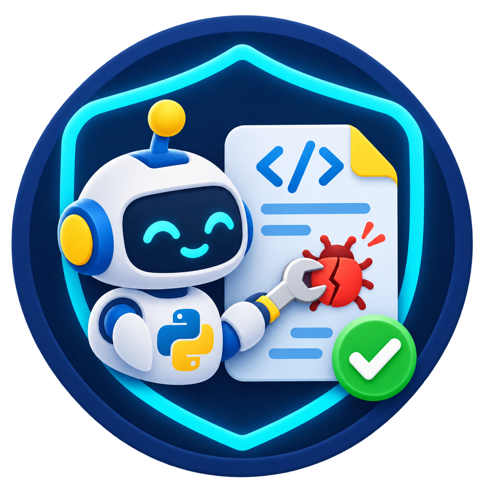
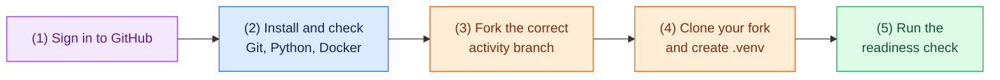

<h1 align="center">Python Repair Agent Lab: Pre-lab Setup</h1>

<p align="center">
  
</p>

Complete this page before the lab. It should take about 20 to 30 minutes. At
the end, you will have a working local development environment and a copy of
the correct activity branch. You will not build the agent yet.

## What you need

| Required item | Why the lab needs it |
| --- | --- |
| GitHub account | To fork the activity repository and push your own work. |
| Git | To clone the repository and save your work in commits. |
| Python 3.11 or newer | To build and test the repair-agent application. |
| Docker with Linux containers | To run buggy-project tests safely outside your normal computer. |
| Code editor and coding assistant | To follow the guided vibe-coding tasks. Codex, Claude Code, and Cursor are suitable examples. |
| Internet access | To fork the repository and download Python packages and the Docker image. |

You do **not** need Ollama, a local LLM, an OpenAI key, a GitHub token, a
Langfuse account, or a Docker image before the required lab. Those are optional
extensions and must not delay your preparation.

## Preparation flow



## 1. Install and check the local tools

Install any missing tool using its official page, then close and reopen your
terminal before checking it.

| Tool | Official installation page | Successful check |
| --- | --- | --- |
| Git | [git-scm.com/downloads](https://git-scm.com/downloads/) | `git --version` prints a version. |
| Python | [python.org/downloads](https://www.python.org/downloads/) | Version is 3.11 or newer. |
| Docker on macOS | [Docker Desktop for Mac](https://docs.docker.com/desktop/setup/install/mac-install/) | `docker info` prints a **Server** section. |
| Docker on Windows | [Docker Desktop for Windows](https://docs.docker.com/desktop/setup/install/windows-install/) | `docker info` prints a **Server** section. |
| Docker on Linux | [Docker Desktop for Linux](https://docs.docker.com/desktop/setup/install/linux/) or a working course-provided Docker Engine | `docker info` prints a **Server** section. |

Run the checks that match your operating system.

**macOS or Linux**

```bash
git --version
python3 --version
docker info
```

**Windows PowerShell**

```powershell
git --version
py --version
docker info
```

Start Docker Desktop before running `docker info`. The command must finish
without an error and show information under **Server**. On Windows, Docker
Desktop normally uses Linux containers through WSL 2. If your computer is
managed by an institution or virtualization is disabled, ask for help before
the lab rather than trying to replace Docker with host Python.

Keep free disk space for the Docker image and Python packages. The required
activity does not download a model. The optional `qwen2.5-coder:7b` model is
about 5 GB and is not needed tomorrow.

## 2. Fork the correct activity branch

The guided activity is on the `guided-from-scratch-activity` branch, not the
default `main` branch. Open this exact page in your browser:

<https://github.com/MahiBegoug/coding-agent-lab/tree/guided-from-scratch-activity>

Select **Fork**. If GitHub shows a **Copy the DEFAULT branch only** option,
leave it unchecked. Your fork must include `guided-from-scratch-activity`.

## 3. Clone your fork

Replace `YOUR-USERNAME` with your GitHub username. These commands download the
guided activity, not the default starter.

```bash
git clone --branch guided-from-scratch-activity --single-branch https://github.com/YOUR-USERNAME/coding-agent-lab.git
cd coding-agent-lab
git branch --show-current
git remote -v
```

Expected outcome:

- `git branch --show-current` prints `guided-from-scratch-activity`.
- `git remote -v` shows a URL containing **your** GitHub username.

Do not run `git init`. Cloning already created the Git repository. Do not
create the `build-repair-agent` work branch yet; Task 0 starts with that step.

If Git says that it cannot find `guided-from-scratch-activity`, delete only
this incomplete clone, return to Step 2, and make sure your fork includes all
branches. Do not continue from `main`.

## 4. Create the Python environment and install packages

Run these commands from the `coding-agent-lab` folder you just cloned.

**macOS or Linux**

```bash
python3 -m venv .venv
source .venv/bin/activate
python -m pip install --upgrade pip
python -m pip install -r requirements.txt
python -m pip check
```

**Windows PowerShell**

```powershell
py -m venv .venv
.\.venv\Scripts\Activate.ps1
python -m pip install --upgrade pip
python -m pip install -r requirements.txt
python -m pip check
```

If PowerShell blocks activation, run this once in the current PowerShell window
and then activate the environment again:

```powershell
Set-ExecutionPolicy -Scope Process -ExecutionPolicy Bypass
```

Expected outcome: `python -m pip check` reports no broken requirements.

Do **not** run `pytest` yet. The supplied `evals/` projects intentionally
contain bugs, and Task 0 will create `pytest.ini` to ensure that host Python
never runs those project tests.

## 5. Readiness check

With `.venv` active and Docker running, run the commands below.

**macOS or Linux**

```bash
git branch --show-current
git status --short
python --version
python -m pip check
docker info --format '{{.ServerVersion}}'
```

**Windows PowerShell**

```powershell
git branch --show-current
git status --short
python --version
python -m pip check
docker info --format '{{.ServerVersion}}'
```

You are ready when all statements below are true:

- [ ] The branch is `guided-from-scratch-activity`.
- [ ] `git status --short` is empty immediately after the clone and package setup.
- [ ] Python is version 3.11 or newer.
- [ ] `python -m pip check` reports no broken requirements.
- [ ] Docker prints a server version instead of an error.
- [ ] You can sign in to GitHub and see your fork.

## If a check fails

Do not spend the laboratory time solving a computer-installation problem.
Before class, send the instructor this small report, with no passwords, API
keys, or tokens:

```text
Operating system and version:
Git command and output:
Python command and output:
Docker command and complete error:
At which numbered preparation step did it fail?
```

Common fixes:

| Problem | First action |
| --- | --- |
| `git`, `python3`, `py`, or `docker` is not found | Install the missing tool from the links above, then reopen the terminal. |
| `docker info` cannot connect to the daemon | Start Docker Desktop and wait until it reports that the engine is running. |
| Docker will not start on Windows | Check the Docker Desktop message about WSL 2 or hardware virtualization; institutional devices may need IT support. |
| `pip install` fails | Confirm Internet access and available disk space. Keep the full error for the instructor. |
| The clone is on `main` | Delete that incomplete clone and repeat Step 2 and Step 3 with `guided-from-scratch-activity`. |

## Tomorrow: where to begin

Bring your laptop, charger, GitHub sign-in, and this completed environment.
At the start of the lab, open the [activity overview](../README.md), then
follow [Task 0: Set up the repository and environment](../tasks/00-setup.md).
