# Task 0: Set up the repository and environment, 10 minutes

[Back to the activity overview](../README.md)

## Setup flow

```mermaid
flowchart LR
    fork["(1) Fork the course repository"] --> clone["(2) Clone your fork"]
    clone --> branch["(3) Create your work branch"]
    branch --> structure["(4) Create the initial folders\nand pytest.ini"]
    structure --> environment["(5) Create the Python environment\nand install dependencies"]
    environment --> check["(6) Run the setup checkpoint"]

    classDef gitBox fill:#f3e8ff,stroke:#9333ea,color:#581c87
    classDef setupBox fill:#dbeafe,stroke:#2563eb,color:#172554
    classDef environmentBox fill:#dcfce7,stroke:#16a34a,color:#14532d
    classDef checkBox fill:#e0f2fe,stroke:#0284c7,color:#0c4a6e

    class fork,clone,branch gitBox
    class structure setupBox
    class environment environmentBox
    class check checkBox
```



## 1. Create your working copy

Open the course repository on GitHub and select **Fork**. GitHub creates a copy
under your own account. Then clone that copy and create a branch for this
activity. Replace `YOUR-USERNAME` with your GitHub username.

```bash
git clone https://github.com/YOUR-USERNAME/coding-agent-lab.git
cd coding-agent-lab
git switch -c build-repair-agent
```

Do not run `git init` before or after `git clone`: cloning already creates the
local Git repository and configures its `origin` remote. Confirm that you are
working from your fork and on the activity branch:

```bash
git remote -v
git branch --show-current
```

The expected branch name is `build-repair-agent`.

### Set Git author information if needed

You will make a commit after this setup task. Git needs a name and email for
that commit. Check whether this computer already has them configured:

```bash
git config user.name
git config user.email
```

If either command does not print a value, set a repository-only identity. Use
your own name and email address:

```bash
git config --local user.name "Your Name"
git config --local user.email "you@example.com"
```

## 2. Create the initial file structure

The starter already provides `requirements.txt` with the Python libraries used
in this lab. Ask your coding assistant to create the target folders, empty
package files, and `pytest.ini`. Use Python 3.11 or newer. `pytest.ini` must
set `testpaths = tests` so that a host pytest command never discovers or
executes tests inside `evals/`.

```ini
[pytest]
testpaths = tests
```

## 3. Create the Python environment

**macOS or Linux**

```bash
python3 -m venv .venv
source .venv/bin/activate
python -m pip install --upgrade pip
python -m pip install -r requirements.txt
```

**Windows PowerShell**

```powershell
py -m venv .venv
.\.venv\Scripts\Activate.ps1
python -m pip install --upgrade pip
python -m pip install -r requirements.txt
```

If PowerShell blocks activation, run `Set-ExecutionPolicy -Scope Process -ExecutionPolicy Bypass` and activate the environment again.

## 4. Checkpoint

```bash
python --version
python -m pip check
git status --short
```

At this point, do not run `pytest` from the repository root: the supplied
evaluation tests are intentionally buggy and must run only in Docker. Commit
the file structure and dependency file before starting Task 1.

## Where to go next

Open [Task 1: Define the core vocabulary](01-core-vocabulary.md).
