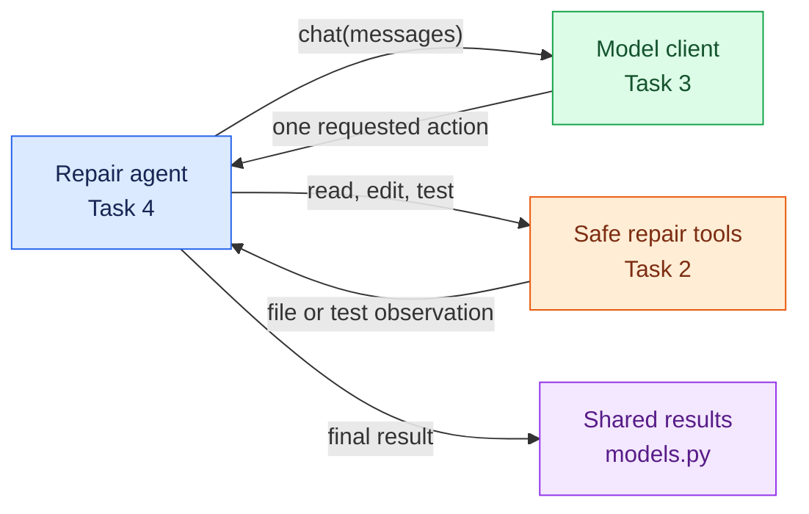

# Task 1: Define the agent's small vocabulary, 15 minutes

[Back to the activity overview](../README.md)

## Why these two files come first

You will build the repair loop in Task 4. That loop needs to talk to a model,
ask tools to read, edit, and test code, and return a result. Before building
those parts, give them a common vocabulary and a small set of promises.



`core/models.py` defines the structured information that moves through this
workflow. `core/ports.py` defines the small operations that the future repair
agent may ask another part of the program to perform. Neither file performs
an API call, starts Docker, or displays a web page.

| File | Why it exists | What you create now |
| --- | --- | --- |
| `core/models.py` | Every part of the agent needs the same names and shapes for results. This avoids passing loose dictionaries with inconsistent keys. | Three small `@dataclass` containers for a test result, a model action, and a final repair result. |
| `core/ports.py` | The repair loop should work with either a scripted client or Ollama, and with real tools or test doubles. | Descriptions of a chat client, repair tools, and an optional trace recorder. |

A Python `Protocol` is a type-level promise: it says which methods an object
must provide without choosing its implementation. For example, the repair
agent only needs an object with `chat(messages) -> str`; Task 3 will later
provide concrete scripted and Ollama clients that satisfy that promise.

## Your task

Create `core/models.py` and `core/ports.py` only.

In `core/models.py`, create three small Python classes using `@dataclass`.
Each class is simply a named container for related information, similar to a
short form with labelled fields. Create one class for:

- a test result: `passed`, `output`, and `returncode`;
- an action requested by the model: `tool`, arguments, and optional public `summary`; and
- the final repair result: whether it passed, trace entries, changed files, workspace location, and the most recent test result.

In `core/ports.py`, describe the capabilities that the repair agent needs:

- a chat client with `chat(messages) -> str`;
- repair tools with `read_file`, `edit_file`, and `run_tests`; and
- optionally, a trace recorder with one `record(event, payload)` method.

Use Python `Protocol` types or small abstract interfaces. The repair agent will
depend on these descriptions, not on Ollama or Docker classes. It is expected
that this task does not repair a project or call an LLM yet.

## Prompt for your coding assistant

Copy this prompt into your coding assistant. Its purpose is to keep the first
change small: create only the shared vocabulary and contracts that later tasks
will use.

```text
Create core/models.py and core/ports.py only. Use @dataclass to define three
small named containers: repair result, test result, and model action. Define interfaces
for a chat client and the three repair tools: read_file, edit_file, run_tests.
Use only the standard library and core modules. Do not import adapters,
Docker, Gradio, or an HTTP client. Add concise docstrings.
```

## Checkpoint

```bash
python -m compileall -q core
```

Expected outcome: the new `core/` package compiles. You now have the shared
names and contracts needed to build the concrete safe tools in Task 2.

## Where to go next

Open [Task 2: Build the sandbox tools](02-sandbox-tools.md).
