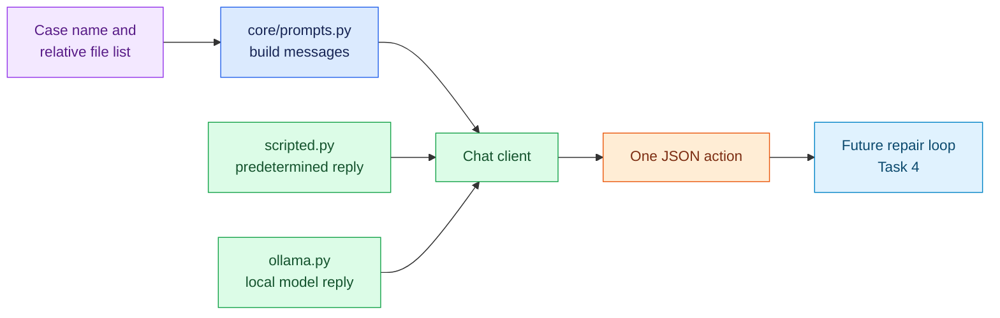

# Task 3: Add prompts and model clients, 15 minutes

[Back to the activity overview](../README.md)

## Why this task comes next

The future repair loop sends the model a request containing the selected
project and the permitted actions. The model replies with one requested action,
for example `{"tool":"run_tests"}`. These messages do not contain the same
information: the request gives context, while the reply chooses a next step.
A fixed reply shape lets ordinary Python code check the action and call an
allowed tool instead of trying to interpret free-form prose. Prompts build the
request; model clients deliver it to either a repeatable scripted client or a
local Ollama model.



The scripted client is the required route for reliable unit tests. A local
Ollama client is prepared here but is needed only for the optional live-model
demonstration.

## Prompt for your coding assistant

Copy this prompt into your coding assistant. It defines the complete scope of
this task.

```text
Implement only core/prompts.py, adapters/models/scripted.py, and
adapters/models/ollama.py. Put all text sent to the model in core/prompts.py.
Provide helpers that build a system message, a case request containing the
selected case name and supplied relative file list, and a tool-observation
message. The system message must say: repair an existing bug; inspect local
code; reproduce the failure by testing before editing; make focused edits; and
verify the repair by testing again. It must require exactly one JSON object,
not Markdown or hidden reasoning.

Allow only these JSON actions: read_file with a relative path, run_tests, and
edit_file with a relative path and replacement content. Support an optional
public summary. Parse and validate model text into the ModelAction from
core/models.py; reject invalid JSON, unknown tools, missing required fields,
and paths not supplied by the case file list. Do not execute a tool here.
Use this wire format, converting path and content into the action's arguments
field after parsing:
{"tool":"read_file","path":"test_calculator.py","summary":"Read the test"}
{"tool":"run_tests","summary":"Reproduce the failure"}
{"tool":"edit_file","path":"calculator.py","content":"..."}

Implement ScriptedClient as the ChatClient protocol using a predetermined
sequence of response strings; it must make repair-loop tests deterministic and
must not contact a model or the Internet. Implement an Ollama ChatClient that
calls a local Ollama server, defaults to qwen2.5-coder:7b, accepts an explicit
model setting or OLLAMA_MODEL override, and accepts a configurable temperature.
Request JSON output from Ollama but keep the independent parser and validator.
Use concise docstrings. Do not add Docker, Gradio, a shell tool, or new Python
packages.
```

### A term used in the prompt

**Strict JSON** means the model reply must be one valid JSON object with only
the supported action fields. Asking for JSON is helpful, but the program must
still parse and validate the returned text before it can use an action.

## Checkpoint

```bash
python -m compileall -q core adapters/models
```

Expected outcome: the prompt helpers and both client modules compile. No live
model call is required for this task.

## Where to go next

Open [Task 4: Implement the repair loop](04-repair-loop.md).
