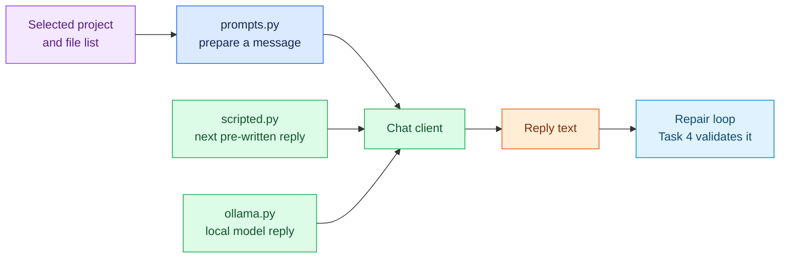

# Task 3: Prepare messages and model clients, 15 minutes

[Back to the activity overview](../README.md)

## Why this task comes next

Before the repair loop can ask a model for help, it needs two things:

- a prepared message that explains the selected project and the allowed next
  steps; and
- a client that sends that message and returns the model's reply.

For the required tests, `scripted.py` is a **pretend model**. You give it a
list of replies in advance, and each call returns the next reply from that
list. It never starts an LLM, contacts the Internet, or introduces random
behaviour. This lets students test the repair loop reliably. `ollama.py` is
the optional connector to a real local model for the live demonstration.



## Prompt for your coding assistant

Copy this prompt into your coding assistant. It defines the complete scope of
this task.

```text
Implement only core/prompts.py, adapters/models/scripted.py, and
adapters/models/ollama.py.

In core/prompts.py, keep all text sent to the model in small helper functions:
one system instruction, one request that includes the selected case name and
supplied relative file list, and one message for a tool result. The system
instruction must tell the model to inspect local code, reproduce the failing
test before editing, make a focused edit, and verify with tests. It must ask
for one JSON object only, with no Markdown or prose. The only allowed actions
are these examples:
{"tool":"read_file","path":"test_calculator.py","summary":"Read the test"}
{"tool":"run_tests","summary":"Reproduce the failure"}
{"tool":"edit_file","path":"calculator.py","content":"..."}
The optional summary is a short label shown in the trace, not private reasoning.
Do not parse or execute a reply in this file; Task 4 does that.

In adapters/models/scripted.py, implement the existing ChatClient protocol as
a pretend model. Accept a list of pre-written reply strings. Each chat call
returns the next string; raise a clear error if the list is exhausted. It must
not call a model, Docker, or the Internet.

In adapters/models/ollama.py, implement the same ChatClient protocol for a
local Ollama server. Use qwen2.5-coder:7b as the default model, allow an
explicit model setting or OLLAMA_MODEL to replace it, and make temperature
configurable. Request JSON output, but do not parse or validate it here; Task
4 will validate every reply. Use concise docstrings. Do not add Docker,
Gradio, a shell tool, or new Python packages.
```

### A term used in the prompt

**JSON** is a compact text format for labelled information. For example,
`{"tool":"run_tests"}` tells the repair loop exactly which permitted action
the model wants next. In Task 4, the loop will check that this text is valid
before it does anything.

## Checkpoint

```bash
python -m compileall -q core adapters/models
```

Expected outcome: the message helpers and both client modules compile. No live
model call is required for this task.

## Where to go next

Open [Task 4: Implement the repair loop](04-repair-loop.md).
